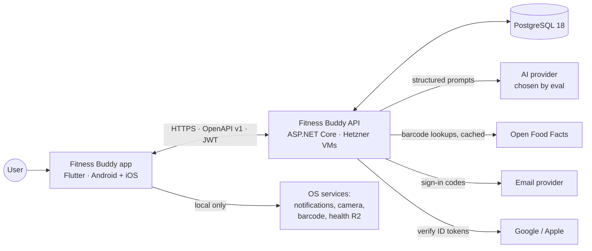

# 03 — System & App Architecture

_The shape of the whole system, the app's internal structure, and the patterns that carry the core product promises. The backend's internals are in `04`, hosting in `08`._

## 1. System context



| Part | Responsibility | Doesn't |
|---|---|---|
| **App** | Holds all user data locally (source of truth). Computes every number: nutrition, proposals, targets, trend, Q&A answers. Works offline except for AI | Trust the network for anything the user needs right now |
| **API** | Identity, the account's synced copy of data (+ 30-day history), AI interpretation, food catalog and barcode lookups, usage counting, account deletion | Compute nutrition numbers. Understand the user's data model beyond validating it (TD-031). Send identity to the AI provider |
| **Postgres** | The only stateful server component | Talk to the app directly |

**The contract** (`contracts/openapi.yaml`, `04` §4) is the only coupling between app and API. Either side can be rewritten without touching the other, as long as the contract holds.

## 2. App architecture: layers

Based on Flutter's official architecture guidance (UI layer → domain layer → data layer, one-way data flow, single source of truth), adapted to local-first:

```
┌──────────────────────────────────────────────────────────────────────┐
│ PRESENTATION   Widgets (dumb, from fb_design_system)                 │
│                ViewModels = Riverpod Notifiers exposing immutable    │
│                UI state; call application commands                   │
├──────────────────────────────────────────────────────────────────────┤
│ APPLICATION    Commands / use cases: LogQuickAdd, ConfirmProposal,   │
│                SendBuddyMessage, ImportWeights, ApplyTargetChange…   │
│                ChangeSetApplier (the only writer) · UndoStack ·      │
│                DomainEventBus · BuddyMessageQueue · SyncEngine port  │
├──────────────────────────────────────────────────────────────────────┤
│ DOMAIN (pure Dart package fb_domain, no Flutter, no I/O)             │
│   Entities & value objects · NutritionCalculator · YieldConverter ·  │
│   ProposalEngine · TargetCalculator · WeeklyBudget/Rebalancer ·      │
│   SafetyRules · TrendWeight · AdaptiveExpenditure · PR/e1RM ·        │
│   NotificationPlanner · RamadanCalendar · SlotAssigner · QueryEngine │
│   UserModel (habits & memory) · NumberGuard                          │
├──────────────────────────────────────────────────────────────────────┤
│ DATA           Repositories (read streams + internal write API)      │
│                drift DB + DAOs · OfflineCatalog (FTS5) ·             │
│                ApiClient (generated, fb_api_client) · SyncEngine ·   │
│                Settings store                                        │
├──────────────────────────────────────────────────────────────────────┤
│ PLATFORM       Notifications scheduler · Camera/image · Barcode ·    │
│                Secure storage · Connectivity · Haptics · Health (R2) │
└──────────────────────────────────────────────────────────────────────┘
```

Rules:
1. **Dependencies point down only.** Domain depends on nothing. The UI never touches drift or HTTP directly.
2. **Domain is pure and deterministic.** Time, IDs and settings are inputs (no `DateTime.now()` inside). 100% unit-testable. Shared with the Dart tools (`buddy_eval`, `catalog`).
3. **Reads are reactive.** drift `watch()` → repository stream → Riverpod provider → widget. Confirming a proposal updates every screen by itself (UX-025).
4. **Writes go through commands → `ChangeSetApplier`** (§5). There is no other path.

## 3. Modules (app side)

### 3.1 Dart packages (hard boundaries, enforced by the compiler)

```
packages/
  fb_domain/          pure Dart · models + all business rules + algorithms
  fb_text/            pure Dart · Arabic/Arabizi normalization, unit & number parsing
  fb_api_client/      pure Dart · GENERATED from contracts/openapi.yaml (never hand-edited)
  fb_design_system/   Flutter  · tokens, themes, components, chart widgets
apps/mobile/          Flutter  · features + application + data + platform
tools/buddy_eval/     Dart CLI · AI acceptance tests (calls the API + runs ProposalEngine)
tools/catalog/        Dart CLI · builds/validates the food catalog + offline pack
tools/trace/          Dart CLI · requirement traceability report
```

### 3.2 Feature folders inside the app (soft boundaries, enforced by a CI check)

```
apps/mobile/lib/
  app/            composition root: bootstrap, router (the only go_router user), shell,
                  root provider overrides, theme wiring
  core/           db (drift schema, migrations), sync, api (client wiring, auth interceptor),
                  errors, events, undo, l10n, config (flavor config, remote config),
                  storage (small settings: device id, config cache), ids (ID generator port),
                  navigation (typed `AppRoute`s + the `AppNavigator` port; go_router stays in app/router)
  features/
    today/        Today screen composition (HM-*)
    me/           Me tab composition: profile, goals, targets, "Buddy remembers", settings (UX-010)
    buddy/        input bar, chat sheet, proposal cards, message queue (AI-*)
    diary/        entries, slots, groups, day marks, copy/move (DY-001–032)
    foods/        search, barcode, label scan, personal foods, saved meals (FD-*)
    batches/      batch dishes & leftovers (DY-040–045)
    targets/      profile, goals/phases, targets, adaptive check-in (TG-*)
    body/         weigh-ins, trend, measurements, import (WB-*)
    workouts/     library, templates, plan, sessions, history, PRs (WO-*)
    progress/     charts, weekly summary, weekly review (IN-*)
    memory/       "Buddy remembers" + user model (AI-080–084)
    notifications/ preferences + planner wiring (NT-*)
    ramadan/      mode, calendar, prayer times (LC-030–034)
    account/      sign-in, guest, export, deletion, sync status (AC-*)
    settings/     units, language, week start, halal, about (LC-*)
    onboarding/   R1 minimal setup, R2 guided (UX-060/061)
```

Each feature has the same anatomy: `<feature>.dart` (the barrel, the only file others may import), `presentation/`, `application/`, `data/`.

**Cross-feature rule:** features import each other only through barrels. Features never import `app/` (the composition root): they navigate through the `AppNavigator` port in `core/navigation/` (S06 A2). Cross-cutting reactions ("diary changed → reschedule notifications", "weigh-in saved → refresh trend") go through **domain events**, not direct calls.

**Enforced by `tools/app_check`** (`make app-check`, part of `make check-dart` and CI): feature barrels, `presentation/` never imports `data/`, I/O packages (dio, the API client, drift, shared_preferences, Sentry) only in `data/` and `core/`, `core/` never imports `features/` or `app/`, features never import `app/`, presentation never imports `core/api|db|sync`, go_router only in `app/router/`, no raw user-facing strings, no left/right layout APIs. Rules, fixes and the `// app-check: allow <rule-id> <reason>` escape hatch (only for `raw-string` and `directional`; the import boundaries have none): `tools/app_check/README.md`.

## 4. Read model

- **Base data** lives in drift tables (`05`).
- **Derived values** (day totals, remaining calories, week position, trend, PRs, weekly summary) are **computed by domain functions** over repository streams and memoised by Riverpod. They aren't stored, so past values always reflect corrected history (G10).
- **Performance:** a heavy user logs ~5,500 entries a year. Daily totals are indexed SQL aggregates (< 10 ms). A cache table is added only if a long-range chart is measured to be slow.

## 5. Write model: actions, proposals and change sets (the core pattern)

This one pattern implements D-079, AI-035/036/048, UX-030, AC-012 and AQ-01.

### 5.1 Concepts

| Concept | What it is |
|---|---|
| `ChangeOp` | One typed operation on user data: `CreateDiaryEntry`, `UpdateDiaryEntry(id, expectedVersion, patch)`, `DeleteDiaryEntry(id, expectedVersion)`, `CreateWeighIn`, `CreateWorkoutSession`, `UpsertPersonalFood`, `CreateBatch`, `ConsumeBatchPortion`, `UpsertMemory`, `ApplyTargetSettings`, `MarkDay`… (sealed class) |
| `ChangeSet` | An ordered list of `ChangeOp`s applied **atomically** (one SQLite transaction) |
| **Direct action** | A user tap produces a `ChangeSet` → applied immediately → its **inverse** goes to the `UndoStack` → 5 s undo snackbar (AI-048, UX-030) |
| **Proposal** | Buddy's output: presentation data + a **draft `ChangeSet`**. Stored as `pending`. Never applied until the user taps confirm (AI-036) |
| `ChangeSetApplier` | The **only** component allowed to write user-data tables. Validates preconditions, applies ops, writes the sync outbox, emits domain events, returns the inverse |

### 5.2 Flow

```mermaid
sequenceDiagram
  participant U as User
  participant UI as Proposal card (UI)
  participant PE as ProposalEngine (domain)
  participant A as ChangeSetApplier
  participant DB as drift (SQLite)
  participant EV as DomainEventBus
  UI->>PE: interpretation + user context
  PE-->>UI: ProposalDraft (numbers, chips, ≤2 questions, draft ChangeSet)
  U->>UI: taps chip / edits amount
  UI->>PE: recompute (local, instant, no AI)
  PE-->>UI: updated draft (changes highlighted, UX-024)
  U->>UI: taps "Log it"
  UI->>A: apply(draft ChangeSet, origin=proposal#id)
  A->>DB: BEGIN; check expectedVersions; write rows; write outbox; mark proposal confirmed; COMMIT
  A-->>UI: inverse ChangeSet (undo)
  A->>EV: EntriesLogged, ProposalConfirmed…
  EV-->>EV: notification planner, user model, quick-add ranker react
```

### 5.3 Guarantees and how they're enforced

| Guarantee | Mechanism |
|---|---|
| **AI never writes** (AQ-01) | The API's Buddy responses are **interpretations only**. The contract has no write types there. On the client, repositories expose writes only to `ChangeSetApplier` (library-private), and an architecture test fails the build if anything else imports the write API |
| **Confirm is safe if data changed meanwhile** | Update/Delete ops carry `expectedVersion`. On a mismatch the applier rejects, and Buddy rebuilds the proposal against current data |
| **Atomic** | One transaction per change set |
| **Undo** | The inverse change set is computed at apply time. Undo is just another change set, so it syncs correctly |
| **Auditability** | Each written row records `origin` (direct action / proposal ID) and `edited_by_user` |
| **Memory only from confirmed data** (AI-081) | The user model subscribes to `ProposalConfirmed` / `EntriesLogged`, never to drafts |

## 6. Buddy message lifecycle (app side)

1. User sends → a `chat_messages` row is saved **immediately** as `queued`. The text can never be lost (UX-052).
2. Online: the `BuddyMessageQueue` calls `POST /v1/buddy/interpret` with the message ID as `Idempotency-Key`. A skeleton card shows at once (AI-030).
3. Response (an `Interpretation`) → `ProposalEngine` builds drafts → `proposals` rows (`pending`) → cards render.
4. Offline, timeout or AI unavailable → `pending_offline`. It shows in the "to confirm / will process" strip (AI-047, AI-153), and the queue retries on reconnect or app foreground, with backoff (TQ-03).
5. A follow-up typed while a card is open (AI-044) is sent with `activeProposalId` + the current draft summary, and the result replaces that card's draft.

## 7. Cross-boundary contracts

| Boundary | Contract | Source of truth | Enforcement |
|---|---|---|---|
| App ↔ API | REST/JSON v1 | `contracts/openapi.yaml` | Generated Dart client, server conformance test, oasdiff (`04` §4) |
| App local schema ↔ server documents | Entity JSON schemas + `schemaVersion` | `contracts/openapi/` (sync components) | Server validates payloads. App migrations + upgraders (`05` §5) |
| Text normalization (Dart ↔ C#) | Behaviour defined by golden cases | `contracts/testdata/normalization_cases.yaml` | Both test suites run the same file (TD-030) |
| Catalog build ↔ app offline pack ↔ server catalog | Catalog schema + stable IDs | `tools/catalog` | CI build + validation (`07`) |
| API ↔ AI provider | Internal JSON schemas per task | Buddy module (`06` §3) | Schema validation + eval suite |
