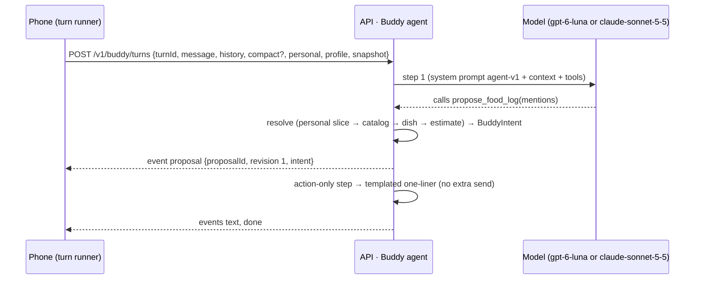

# 06 — Buddy: AI Architecture (agent, D-100)

_How Buddy meets `10-ai-assistant.md` (§1–§15) as an **agent**: a tool loop on the server, shared knowledge from the server, personal data from the phone on demand, every write a proposal. Decisions: TD-124 (loop and budgets), TD-125 (turn protocol and recovery), TD-126 (conversation and context), TD-127 (tools, scopes, proposal identity, facts), TD-128 (quality, retirement, limits). TD-035 still holds for the stack (Microsoft.Extensions.AI, no framework, versioned prompts, content-free telemetry). Server side: the **Buddy module** (`04`). Client side: the turn runner, phone tools and cards in `apps/mobile/lib/features/buddy`, the deterministic engines in `fb_domain`._

## 1. Principles

1. **AI interprets and decides, code computes.** The model chooses steps and actions. Every number comes from the catalog, the user's data or code (`compute`, ProposalEngine, QueryEngine), and every number in Buddy's words is a **code-filled fact** (§7). The badged AI estimate (AI-070) is the only model number, as before.
2. **Nothing is written without confirmation.** Action tools emit proposals; only `ChangeSetApplier` on the phone writes, and only after a user tap (D-079, AQ-01). The Buddy module has no write path to user data (an architecture rule, tested).
3. **Server-first knowledge, phone-held data.** Shared data (foods, dishes, barcodes, portions, yields, halal flags) is a server tool. Personal data reaches the model only as (a) a small pre-matched slice in each request and (b) phone tools with **phone-enforced scopes and a per-turn disclosure budget** (§4.2).
4. **Stateless execution.** The Buddy agent keeps no conversation or turn state between rounds beyond **content-free ledger rows** (TD-125); a paused turn's model context travels in a sealed continuation. The chat, its summary and memory are **user data**: stored on the phone and synced like other entities (the server's sync copy, B05/B18), but the agent never reads them from the server, only what the phone sends in a request.
5. **Minimum context, no identity.** Handles instead of IDs, no name/email/account fields, an allowlisted snapshot (AC-041).
6. **Experiments, not an eval gate** (TD-128). The trace view (AI-172) shows what each step did; tuning follows the owner's use.

## 2. A turn



When the model calls a **phone tool**, the round ends with a `phoneTools` event `{calls, continuation}`; the phone runs the calls locally under its scopes and posts `POST /v1/buddy/turns/continue {turnId, round, continuation, results}`, which streams the next round. Several phone calls in one step are answered together.

**The loop (TD-124), per step:**
1. Check the **turn budget** (below). Exhausted → deterministic wrap-up (step 5), no send.
2. Reserve a send in Usage and record it on the ledger round (content-free). Quota denied → wrap-up with `done reason quota`.
3. Call the model with the messages so far and the tool declarations (no automatic invocation); at most **6 tool calls** per step are honoured, extra calls get `error tooMany` results.
4. No tool calls → final text: render facts and run the guards (§7), stream it, emit any `summary` (§6), then `done`. Tool calls → run every server tool (parallel, each ≤ 5 s), append size-capped results (≤ 8 KiB per result to the model). Any phone tool among them → seal the continuation, emit `phoneTools`, end the round. A terminal tool (`ask_user`, `decline`) ends the turn after its event.
5. **Wrap-up at any limit** (steps, sends, tokens, deadline, quota): no model call. The server emits a templated line ("Here's what I have so far" + the cards already emitted, or "I couldn't finish that, try again" when there are none) and `done reason limit|quota`.

**One turn budget, authoritative on the server** (config `Buddy:Agent`): deadline **60 s from the turn's first start** (ledger time, not the phone's), **10 sends** (model steps, guard rewrites and the summary step all count), **3 phone rounds**, **64k input / 8k output tokens** cumulative. The counters live in the ledger turn row and in the continuation (the ledger wins). A send costs allowance sends; the turn costs **one** allowance message however many rounds or retries it takes.

**Cancellation.** The stop button closes the stream: the server cancels the in-flight model call and records the round as cancelled. The server can't tell a stop from a dropped connection, so a cancelled round is retry-eligible like any unacknowledged round (§3.4); the phone simply never retries after a user stop. If the turn is paused on a phone round, stopping means the phone simply never posts `continue`; the continuation expires (10 min) and nothing else runs. No cancel endpoint. Late events or results for a stopped turn are ignored by the phone.

**Fast path.** For "2 eggs" the model calls `propose_food_log` directly; the tool resolves foods with the request's **personal slice first** (AI-070 precedence, §3.1), then the catalog, reference dishes and the badged estimate. When every call of a step is an action tool and the message asked nothing, the server ends the turn with a templated one-liner ("Here's your breakfast · {fact} left after this") without another model call: one send per simple log.

## 3. Contract (TD-125, `contracts/openapi/modules/buddy.yaml`)

### 3.1 Start

```text
BuddyTurnStart {
  turnId               // chat message id, UUIDv7, = Idempotency-Key
  mode                 // chat | weeklyReview
  message { text ≤ 2000, image? (JPEG ≤ 1024 px, base64) }
  history [≤ 12] { messageId, role user|buddy, text ≤ 1000, outcomes [≤ 6] { proposalId, kind, status confirmed|edited|discarded|pending, label ≤ 120 } }
  summary? { text ≤ 1500, revision, watermark (last summarised messageId) }
  compact? { evicted [≤ 24 entries, same shape as history], previousRevision }   // §6
  personal [≤ 20] { ref (local ID), kind personalFood|savedMeal|batch|usual, names, aliases, state?, per100?, servings?, portions? }   // pre-matched on the phone against the message tokens
  profile { memory [≤ 30] {kind, key, value}, defaults [≤ 20] {kind, subject, value} (confirmed habits: weighing state, cooking fat, variants, portions), halal, units {mass, energy}, ramadan {active, fajr?, maghrib?} }
  snapshot { now, tzOffsetMin, slots [≤ 12] {id, name, window}, today { kcal, protein, carbs, fat, fiber, targets {…} }, openCards [≤ 5] { proposalId, revision, kind, summary ≤ 200 } }
  weekly? { WeeklySummary aggregates }   // mode weeklyReview only
  ackTurn? { turnId }  // acknowledges the previous turn's final round (§3.4)
  priorAttempt?        // retries only (§3.4)
  trace: bool          // dev builds only; honoured only when Buddy:Agent:TraceEnabled
}
```

The **personal slice** is how personal-food precedence holds without a phone round trip: the phone matches the message's normalized tokens against its personal foods, saved meals, open batches and usual meals (fb_text normalization, the same one the catalog uses) and sends the best ≤ 20 with their facts. `ResolveFoods` consumes it exactly as it consumed interpret's `personalFoods`. Confirmed defaults and learned habits ride in `profile.defaults`, so the ProposalEngine and the model see the same defaults.

### 3.2 Continue

```text
BuddyTurnContinue { turnId, round, continuation (opaque string ≤ 256 KiB), results [ { callId, ok, data? (tool-specific schema), error? code } ], priorAttempt? }

PriorAttempt { attempt, cards [≤ 12] { proposalId, status confirmed|discarded|pending, line ≤ 120 (the card's compact summary) } }   // retries only
```

The server opens the continuation and checks that `results` answers **exactly** the pending call IDs (no missing, extra or duplicate IDs) and that each `data` validates against its tool's result schema and size cap; otherwise `error invalid` with no send.

### 3.3 Events (`text/event-stream`)

Every event carries an SSE `id:` = `{turnId}:{round}:{seq}` and `data:` = one `BuddyTurnEvent` JSON.

| `type` | Payload | App |
|---|---|---|
| `step` | `code`: searchingFoods, readingDiary, readingYourFoods, readingBody, readingWorkouts, readingMemory, computing, checkingFit, writingReply, summarizing | live step line (AI-170), ARB text per code |
| `text` | `text` (a chunk of the rendered, guarded reply; chunks in order) | reply text |
| `proposal` | `proposalId`, `revision`, `replaces?` {proposalId, expectedRevision}, `intent` (a `BuddyIntent`: the B09a union + `measurement`, `workout`, `importRows`, `suggestion`) | ProposalSessionWriter create/update → card |
| `question` | `text`, `options` [2–4] (rendered and guarded like replies) | chips; the tap is the next message (AI-166) |
| `phoneTools` | `round`, `continuation`, `calls` [ {callId, name, args} ] | turn runner runs them, posts continue |
| `summary` | `text` ≤ 1500, `revision`, `watermark` | stored on the phone (AI-165); always **before** `done` |
| `trace` | `steps` [ {tool, args, resultSummary, ms, tokens, usd} ] | dev trace view (AI-172) |
| `done` | `reason` answered\|asked\|declined\|limit\|quota, `usage` {sends, inputTokens, outputTokens} | ends the turn |
| `error` | `code` unavailable\|timeout\|invalid\|roundAlreadyRan\|expired | message stays pending or failed (AI-177) |

**Streaming:** model text is buffered until it passes the fact renderer and guards (§7), then sent in `text` chunks; live progress comes from `step` events. **Transport rules:** flush after every event; a heartbeat comment (`: ping`) every 10 s; headers `Cache-Control: no-cache`, `X-Accel-Buffering: no`; no response compression on these routes. Unknown event types and intent kinds are ignored or routed as `unrecognized` (additive rule, `04` §4.2). Errors before streaming use the usual problem responses (400/401/409/426/429/503).

### 3.4 Identity, continuation and recovery (TD-125)

- **Proposal identity:** `proposalId` = UUIDv5 of `(turnId, round, attempt, index)` (index = order of action calls in that attempt), so a retry's cards never reuse an earlier attempt's IDs. `revision` starts at 1. An update to an earlier card ("make it 2") is an action call with `replaces {proposalId, expectedRevision}` naming an open card from `snapshot.openCards` or history; the new event keeps that `proposalId` with `revision + 1`. The phone's `ProposalSessionWriter` creates or updates; an update whose `expectedRevision` isn't the card's current pending revision is dropped (the card shows "changed meanwhile", AI-044). **Confirm and Apply all** resolve only cards that are still pending at their current revision, in one ChangeSet transaction (one Undo).
- **Continuation:** AES-256-GCM over `{userId, turnId, round, expiresAt (10 min), messages, handleMap, pendingCallIds, budget}`; the key is a server file outside git (`Buddy:Agent:SealKeyFile`), never logged. Associated data binds the API version. Opening checks user, turn, round, expiry and the ledger round state.
- **Ledger** (content-free): a turn row `(turnId, startedAt, sends, tokens, rounds, messageCharged)` and a round row `(turnId, round, state started|completed|cancelled, attempts)`; `attempt` = the round row's attempt number (1, then 2). A round is **completed** when the server has flushed its terminal event (`phoneTools`, `done`, `error`). It is **acknowledged** when the phone posts the next round (`continue` for round r+1), sends `ackTurn` with its next turn, or 10 minutes pass.
- **Recovery after an ambiguous disconnect** (the stream broke before a terminal event, the app died, or the round was cancelled by a disconnect): the phone **retries the same round once with the same request** (the same start body, or the same continuation and results) plus `priorAttempt`. The server: round `started`, `cancelled`, or completed-but-unacknowledged → re-runs it as attempt 2 within the remaining turn budget, **no new allowance message** (sends still count); a third attempt → `error expired`; round acknowledged → `409 roundAlreadyRan`.
- **Reconciling a retry:** the server gives the model the prior attempt's cards as "already handled, do not propose again" (confirmed and discarded ones) or "still open" (pending ones, which the retry may update with `replaces`). On the phone, cards of the earlier attempt that were **confirmed stay**; cards still **pending are dropped** when the retry's first `proposal` or its `done` arrives, unless the retry updated them. **Residual risk:** the model may still re-propose something already confirmed; a card whose food, meal and amount match a card confirmed earlier in the same turn shows a **"possible duplicate"** hint. If the retry also fails, the message is marked failed with "Try again", which starts a new turn.
- **Phone checkpoint** (durable, A66): per in-flight turn the phone stores `turnId`, round, the request body or continuation + results it last sent, the last event `id`, and the proposals received (A23a's durable proposals). After a restart it resumes from the checkpoint by the retry rule above.

## 4. Tools (TD-127)

Tool arguments and results are JSON schemas generated from C# records (internal, versioned with the prompt; the phone-tool call/result schemas are public in the contract). Handles (`f1` food candidate, `d1` reference dish, `e1` diary entry, `p1` personal item, `m1` saved meal, `b1` batch, `c1` open card, `x1` exercise) are turn-scoped and mapped by the server. **Facts are claims:** every tool result that carries a number the model may mention also lists it as a code-labelled claim `{id, metric, operation, period, value, unit, label}`, where `label` is rendered by code from metric + operation + period (e.g. `{id:"k3", metric:"energy", operation:"remaining", period:"today", value:640, unit:"kcal", label:"left today"}` → "640 kcal left today"); the model refers to claims by ID only (§7).

### 4.1 Server tools (inline)

| Tool | Input | Output to the model |
|---|---|---|
| `search_foods` | `query` (canonical English), `arabic?`, `state?`, `kind?` food\|dish\|branded, `limit ≤ 8` | candidates: handle, name, state, per-100 g kcal/P/C/F as facts, servings, source, verified |
| `get_dish` | `dish` handle | variants (handles), typical portions (g) as facts, ingredients summary |
| `lookup_barcode` | `code` | product handle or not found |
| `compute` | `items` [ {food handle, amount, unit, state?, fat?} ] | per-item grams and kcal/macros, totals, yield conversions (code, FD-060/062), all as facts |
| `check_fit` (B26) | `options` [items] | per option: fits kcal/protein against the snapshot's remaining, by how much (facts) |
| `exercise_search` (B26) | `query` | exercise handles from the library + custom names |

### 4.2 Phone tools (pause the turn; run and **scoped by the phone**)

The phone is the data holder, so it enforces each tool's scope whatever the arguments say, and it keeps a **per-turn disclosure budget**: at most **120 rows and 48 KiB across all phone results of a turn**; past it, calls return `ok:false budgetExceeded`. No phone tools in `weeklyReview` mode.

| Tool | Input | Scope enforced on the phone | Output |
|---|---|---|---|
| `find_my_foods` | `query`, `kinds?` personalFood\|savedMeal\|batch\|usual | ≤ 20 matches by name/alias | handles, names, aliases, state, per-100 facts or portions |
| `read_diary` | `date` hint or `range`, `slot?`, `query?` | range ≤ **31 days**, ≤ 40 rows | entries: handle, date, slot, name, grams, kcal |
| `read_body` | `range`, `what` weight\|trend\|measurements | trend over ≤ 365 days as aggregates; raw values ≤ 31 days, ≤ 31 rows | values and trend (code-computed facts) |
| `read_workouts` | `range`, `exercise?` | ≤ 90 days, ≤ 15 sessions | sessions, sets, PRs |
| `read_memory` | `topic?` | ≤ 30 items | memory items |
| `query_data` (A68) | a QueryPlan (§6.3) | any period ≤ 400 days; returns **aggregates only** | computed facts + a link target |

The app returns local IDs; the server swaps them for handles before the model sees them. **Why this matters:** confirmation protects writes, not reads. Text in a message, a label photo or a tool result could try to make Buddy read more of your data than the question needs; the scopes and the budget bound what a single turn can ever send to the model, and the trace view shows every read.

### 4.3 Action tools (emit `proposal`, never write)

Every action tool takes an optional `replaces {card handle}` to update an open card instead of creating one (§3.4).

| Tool | Emits `BuddyIntent` | Resolution |
|---|---|---|
| `propose_food_log` | `foodLog` (items with alternatives and dimensions, §5) | B08 `ResolveFoods`: personal slice → catalog → reference dish → badged estimate |
| `propose_diary_edit` / `propose_diary_delete` / `propose_diary_copy` | `diaryEdit`, `diaryDelete`, `ambiguousReference`, `diaryCopy` | `ResolveReferences`, TD-091 policy over entry handles |
| `propose_saved_meal` | `savedMealLog`, `savedMealCreate` | handles → IDs |
| `propose_batch` | `batch`, `batchPortion`, `batchClose` | `ResolveCreations` |
| `propose_personal_food` | `personalFoodCreate` (stated figures literal, TD-092) | `ResolveCreations` |
| `propose_memory` | `memoryChange` | real matches only (TD-032) |
| `propose_weigh_in` | `weighIn` | — |
| `propose_measurement` (B26) | `measurement` | units checked |
| `propose_workout` (B26) | `workout` (exercise handles, sets) | exercise library + set-notation cross-check (WO-030–033) |
| `propose_import` (B26) | `importRows` | unit inference + plausibility flags on the phone |
| `suggest_foods` | `suggestion` (2–4 options, each a ready `foodLog`) | resolved + `check_fit`; the app drops options that don't fit |

Each returns to the model a compact code-computed summary with facts ("card c2: chicken shawarma 1 sandwich, {k3} kcal, lunch").

### 4.4 Terminal tools

`ask_user {text, options[2–4]}` (≤ 2 per turn, AI-061; text and options rendered and guarded like replies) and `decline {reason offTopic|medical|supplements}` (templated text, SF-030).

## 5. Food items and the ProposalEngine (kept)

`propose_food_log` emits the same `FoodItem` shape as interpret did: match + ≤ 3 distinct alternatives, amount, share, dimensions (state, fat, variant, portion) and an optional badged estimate, so the app's deterministic ProposalEngine (A21) keeps doing the question policy (AI-060/061), yields, fat lines and totals offline. The agent may ask with `ask_user` before proposing, but a card's own dimension questions stay the engine's.

## 6. Conversation, memory, questions about data

### 6.1 History and compaction (TD-126)

- The phone keeps the chat (A22a/A23a storage) and sends the last ≤ 12 entries with card outcomes, plus the current summary `{text, revision, watermark}`.
- **The phone owns compaction.** When entries fall out of the 12-entry window past the summary's watermark, the next start request carries `compact { evicted (≤ 24 entries, oldest first), previousRevision }`. The server answers the message, then runs one summary step over the old summary + evicted entries (counted in the turn budget) and emits `summary {text, revision = previousRevision + 1, watermark = last evicted messageId}` **before** `done`. The phone stores it only if its current revision is still `previousRevision`. If the budget runs out, no summary is sent and the phone retries compaction on the next turn. More than 24 evicted entries: the phone sends the newest 24 and moves the watermark past the rest.

### 6.2 Storage and sync

| Data | Local storage | Sync |
|---|---|---|
| Chat messages, proposals, card outcomes | existing `chatMessage` and `proposal` entities (A22a/A23a, B18) | existing (B18) |
| Conversation summary | new `buddySummary` entity: one row per user `{text, revision, watermark}` (A66) | **new sync entity**, server admission in B25's contract handoff |
| Memory items | new `memoryItem` entity `{kind, key, value, createdFrom explicit\|learned}` (A67; the A66 profile reads it when present) | **new sync entity**, server admission in B25's contract handoff |
| Turn checkpoints, traces | local only (A66), never synced | — |

Syncing makes the chat survive a phone change like other data (SC-6). The agent still only sees what a request carries.

### 6.3 Questions about your data: the QueryPlan grammar (frozen in B25's handoff)

```text
QueryPlan {
  metric: kcal | protein | carbs | fat | fiber | weight | weightTrend | measurement(typeKey) | workouts | sets | volume | exerciseLastDate | exercisePr | weighIns | loggedDays
  op:     total | average | remaining | latest | change | count | max | min | last
  period: today | yesterday | thisWeek | lastWeek | thisMonth | lastMonth | lastNDays(n 1–400) | since(event ramadanStart|phaseStart|date) | range(from, to)  // ≤ 400 days
  filters?: { slot?, exercise? (handle), muscleGroup? (library group, e.g. legs), completeDaysOnly? (default true for averages), weekdays? }
}
→ { facts [ claims as in §4, provenance:"query" ], coverage {days, loggedDays}, link? { screen diary|weightGraph|progress|exercise|workout, params } }
```

Valid combinations (others are unsupported); every metric has at least one: `remaining` only with `today` and the nutrients (kcal, protein, carbs, fat, fiber); `total`/`average`/`max`/`min` with the nutrients, sets and volume; `latest`/`change` with weight, weightTrend, measurement and exercisePr; `count` with workouts, sets, weighIns and loggedDays; **`last` only with exerciseLastDate**, filtered by `exercise` or `muscleGroup`, returning the date as a claim ("last done"), the workout's handle and the exercise's muscle group ("when did I last do legs"). **Units** come from the profile (kcal, g, kg/lb, cm/in). An unsupported plan returns `ok:false unsupportedPlan`; the model then says it can't tell that from your data (AI-111) or asks. The device's `QueryEngine` (A68) computes every number (AQ-09).

### 6.4 Memory and the user model

Explicit memory items and learned habits live on the phone; a ≤ 30-item memory slice and ≤ 20 confirmed defaults go in `profile`, more via `read_memory`. Memory changes are proposals (AI-055). No hidden model-written profile; the summary is shown and clearable in "Buddy remembers".

## 7. Facts and guards on model text

- **Code-filled claims** (AI-175): the model never writes a number for a quantity. It writes `{fact:k3}` references to claims from that turn's tool results, the snapshot or the profile; the server renders **value, unit and the code-made label together** ("640 kcal left today", "2,100 kcal target today"), so a target can't be presented as what's left. The model's own wording around a claim is not checked. Any bare number left in model text, other than a **whitelist** (clock times, calendar dates and weekday/day counts, and the integers 1–10 not followed by a unit word or symbol), triggers **one rewrite** step naming the problem, then a **template** built from the facts. An unknown fact ID is treated the same way. This applies to replies, `ask_user` text and options, suggestion text, the weekly review and summaries.
- **Banned words** (SF-020, AI-142) on all model text → the same rewrite → template.
- **Declines** are templates (AI-176).
- **Injection:** confirmation bounds what injected text can *write*; the phone scopes and disclosure budget (§4.2) bound what it can make Buddy *read*, and nothing read leaves the turn except into proposals and replies the user sees.

## 8. Other flows

| Flow | How |
|---|---|
| Meal photo (AI-011) | the image goes in the start request; the model sees it and proposes as usual; portions from a photo alone are `estimate` |
| Label photo (FD-040–042) | not the agent: `POST /v1/buddy/label` → one structured vision call → `LabelExtraction` → the app's review screen (B26, A69) |
| Paste import (WB-030–032) | `propose_import` rows → review table (B26, A69) |
| Weekly review (AI-130–132) | `mode: weeklyReview` with the `WeeklySummary` aggregates as facts, no phone tools, code-filled facts and guards; cached per week on the phone (B26, A68) |
| Ramadan (RM-*) | `profile.ramadan` in context; Ramadan slot names and suhoor/iftar wording in the prompt (B26, A68) |

## 9. Provider, privacy, cost

- **Model (TD-129):** one setting, `Buddy:Provider`. **`openai`** (default): `gpt-6-luna` through the Responses API (`store:false`, low effort). **`anthropic`**: Claude Sonnet 5.5 (`claude-sonnet-5-5`) through the official SDK's `IChatClient` (Beta Messages): `thinking: between_tools` (no up-front thinking; thinking blocks are never sent back, so history rebuilt from the continuation is always valid), `output_config.effort` medium (`Buddy:AnthropicEffort`; label low), no sampling parameters, `tool_choice` auto or none only (Sonnet 5.5 rejects forced tool use), a tool-less rewrite still declares the tools with `tool_choice: none`; a `refusal` stop takes the existing failure path. Both via `IChatClient` and a per-provider strategy (`Infrastructure/BuddyProvider.cs`); routing task `agent` (plus `label`: OpenAI strict JSON schema; Claude gets the schema in its cached system prompt and answers JSON text, because the label schema exceeds Claude's 16-union structured-output limit). No SDK retries; Claude's server-side refusal fallback is built but off (`Buddy:AnthropicServerFallback`, owner call, TD-067). Other providers need the owner (paid vendor gate).
- **Data handling:** OpenAI with `store:false`; Anthropic doesn't train on API data without permission and deletes API inputs and outputs within 30 days by default (longer only for usage-policy flags or legal holds). Neither is zero-retention.
- **Privacy (AC-040–042):** no identity, handles not IDs, size-capped phone results, photos not stored, no message or tool content in logs or traces (OpenTelemetry content capture off; the dev `trace` event goes only to the phone).
- **Logs:** turn ID hash, step count, tool names, outcome codes, latency, tokens, estimated cost.
- **Prompt caching:** the system prompt and tool declarations first and static; profile and history next; the message and tool results last. OpenAI caches automatically; Claude gets two explicit breakpoints: at the end of the system prompt (tools render first, so it covers tools + `agent-v1` + the shared exercise library) and on the last message (the next step of the turn reads the prefix). One Claude send is ≈ 20k input tokens (OpenAI ≈ 6k), mostly cache reads; with TD-124's 64k turn input budget that is ≈ 3 sends, so a higher `Buddy:Agent:MaxInputTokens` for Claude waits for the owner (B27 D12). Claude prices (2026-11-07): $2/M input, $2.50/M cache write, $0.10/M cache read, $10/M output.
- **Limits** (TD-124, TD-128): one turn budget across rounds (§2); Usage counts every send and one message per turn; laptop defaults 100 messages / 400 sends a day (guest 30/120). Expected cost: a simple log ≈ 1–2 sends, a suggestion or data question ≈ 3–5; with caching ≈ $0.001–0.004 per turn on OpenAI; on Claude Sonnet 5.5 a simple log ≈ $0.008 with a warm cache, ≈ $0.055 cold (cache expired after 5 min), a 3-send suggestion ≈ $0.045 (B27 live).

## 10. Latency

| Turn | Target |
|---|---|
| First `step` event | ≤ 1 s |
| Simple log → card | ≤ 5 s for 9/10 (AI-030); one model step + resolver ≈ 2.5–4 s |
| Multi-step (suggestion, history question) | ≤ 15 s typical, 60 s cap, live steps throughout |

## 11. App components

- **Turn runner** (`BuddyTurnRunner`): builds the start request (history, compaction, personal slice, profile, snapshot), reads the SSE stream (a small framing reader over the generated event types, heartbeat-aware), runs phone tools under their scopes and budget, posts continue, keeps the durable turn checkpoint and applies the retry rule (§3.4), handles stop and failures. Offline or unavailable → the message stays pending and runs when online (AI-047, A23b scope).
- **Phone tools** (`buddy/application/tools/`): one class per tool over the existing repositories, enforcing §4.2's scopes and the per-turn disclosure budget, returning IDs (the server swaps them for handles).
- **Thread UI:** live step line, reply text, question chips, several cards per reply with **Apply all** (only still-pending current revisions, one ChangeSet, one Undo), card updates in place by `proposalId`/`revision`, stop button, pending strip.
- **Trace view** (dev builds and the owner's build): per turn, the `trace` steps, stored with the message locally, never synced.
- **Cards:** the existing food card plus before→after edit, delete, copy, saved meal, weigh-in, memory, batch, personal food (A67); answers with links and suggestions (A68); workout, measurement, import table, label review (A69).

## 12. What was retired (TD-128)

`POST /v1/buddy/interpret`, its single-call prompt and parser (removed after A66 switches the app), `tools/buddy_eval` and the CI `eval` job with the AQ known-miss baseline (TD-097). The resolvers (`ResolveFoods`, `ResolveReferences`, `ResolveCreations`), the closed day-hint grammar and the reference policy (TD-091) live on inside the action tools.
