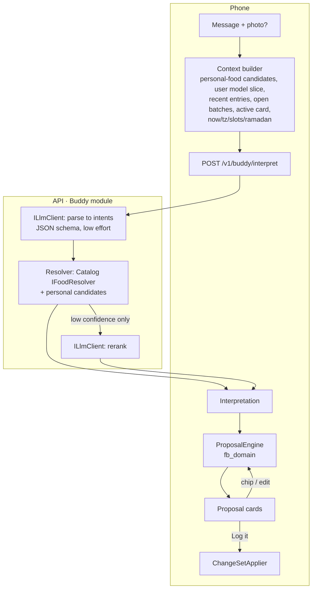

# 06 — Buddy: AI Architecture

_How Buddy meets `10-ai-assistant.md` and the AQ thresholds in `40-acceptance-criteria.md`, cheaply and without ever inventing numbers. Server side: the **Buddy module** of the API (`04`). Client side: `ProposalEngine`, `QueryEngine` and `UserModel` in `fb_domain`._

## 1. Principles

1. **AI understands, code decides.** The model outputs a *structured interpretation*: foods, amounts, states, references. Every number and every spec rule (thresholds, question budget, safety floors) is deterministic Dart in `fb_domain`. Prompts aren't policy.
2. **Hot path = one model call.** Parse → deterministic retrieval → client computation. A second call happens only when measured to help (low-confidence rerank).
3. **Stateless API, minimum context.** The app sends exactly the context a request needs (AC-041). The API forgets after responding.
4. **Every model output is validated** against a JSON schema. Invalid → one repair retry → otherwise a graceful "didn't get that" (AI-150).
5. **Measured, not assumed.** Every prompt or model change runs the eval suite (§11).

## 2. Pipeline overview



## 3. The interpret contract (public, in `contracts/`)

### 3.1 Request

```text
InterpretRequest {
  requestId            // = chat message id (Idempotency-Key, MN-005)
  text, image?         // image: JPEG ≤ 1024 px
  now, tzOffsetMin, ramadan { active, fajr, maghrib }
  slots [ {id, name, window} ]
  activeProposal?      // follow-up edits this card (AI-044)
  context {
    personalFoods [ {id, names, aliases, servings} ]   // pre-filtered on device vs. the message, ≤ 30
    savedMeals [ {id, name} ], openBatches [ {id, name, remaining} ]
    memory [ {kind, key, value} ]                      // the relevant user-model slice (§5)
    recentEntries [ {id, date, slot, name, grams} ]    // last ~3 days, for "the rice", "yesterday's dinner"
    customExercises [ {id, names} ]
  }
}
```

No name, email, user ID or account details are in the payload (AC-041). The API knows the user from the JWT for rate limiting and usage, but **never forwards identity to the AI provider**.

### 3.2 Response: a list of typed intents

| Intent | Content | Becomes |
|---|---|---|
| `FoodLog` | slot/time, optional dish group, items[] (§3.3) | food proposal (AI-030–034) |
| `DiaryEdit` | target entry ID(s), patch (amount / food swap / slot / day) | before→after proposal (AI-050, AI-090) |
| `DiaryDelete` | entry IDs | delete proposal (AI-051) |
| `Copy` | source (date + slot) → target | proposal (DY-032, T23) |
| `WeighIn` · `Measurement` | value, unit, datetime / type | proposal (AI-052, WB-040) |
| `Workout` | date, template ref?, exercises[] with sets | proposal (WO-030–033) |
| `Batch` | ingredients, cooked weight?, portion eaten now? | proposal (AI-100) |
| `PersonalFood` | name, components or per-100 values | proposal (AI-054) |
| `Memory` | kind, key, value | proposal (AI-055) |
| `Question` | **QueryPlan** + answer template (§6) | computed answer (AI-110) |
| `SuggestRequest` | constraints | suggest flow (§7) |
| `Clarify` | what's unclear + chip options | question without a proposal (AI-150, AI-152, T11) |
| `AmbiguousReference` | candidate entry IDs | "which one?" chips (AI-091, T29) |
| `OutOfScope` / `Medical` | — | templated decline (AI-003, SF-030) |

One message can yield several intents (AI-015, T39). Each carries the detected `language` and `script` (EN / AR / Arabizi). **In R1, replies are English** (AI-143, D-080). The language is recorded for per-language eval scores and for R2 (AI-141).

### 3.3 Food items carry their alternatives

The response contains **everything the client needs to recompute any alternative**, so taps never need the network:

```text
FoodItem {
  mention                 // "200g rice"
  match: FoodCandidate    // best match: catalog/personal/reference id, names, per-100 nutrients, state, servings, source
  alternatives: [FoodCandidate] ≤ 3, distinct (PR-5, AI-041)
  amount: { value, unit, grams?, portionWord?, explicit }
  share?: { fraction | people | plates }                   // D-072 "we were 6"
  dimensions: [
    { kind: state,   options: [raw → candidate A, cooked → candidate B], statedValue? }
    { kind: fat,     options: [none, 1 tsp oil, 1 tbsp oil, ...], statedValue? }
    { kind: variant, options: [chicken → ref X, cauliflower → ref Y] }
    { kind: portion, options: [small 250 g, medium 350 g, large 450 g] }
  ]
  estimate?: { range, reason }
}
```

The **ProposalEngine** (client, deterministic) then:
1. Resolves each dimension: stated by the user → saved default (user model) → otherwise a question candidate.
2. Computes kcal under each option, and **asks only if** they differ by > 20% **and** > 50 kcal (AI-060; thresholds served by `/v1/config`). It keeps **at most 2 questions**, ranked by kcal impact (AI-061). The rest become assumption chips (AI-033/034).
3. Applies yield factors when the stated state ≠ the matched food's state, and records "200 g dry ≈ 500 g cooked" (FD-060/062).
4. Adds cooking fat as its own line (AI-022/064), with the "all oil eaten" chip (FD-061).
5. Computes totals and "today after this" from local data (AI-031).
6. Emits the draft `ChangeSet`.

AQ-08 ("> 2 questions: 0 cases") can't be violated, because it's code. The model's job is to *detect* the dimensions, and the eval measures that.

## 4. Number sources & resolution (AI-070)

Resolution order inside the API's resolver (mirrored for personal foods on the client):
1. **Personal context** (IDs the client sent). The model links mentions to them ("my shake").
2. **Verified catalog** (generic + branded), in the right state.
3. **Reference dishes** (reviewed, `07` §4).
4. **AI estimate**, only when nothing matches: per-item kcal and macros **with a range**, marked `estimate` + "AI estimate" (AI-070/151, AQ-10). This is the **only** place model numbers enter, and they're always badged.

Retrieval: the model supplies a **canonical English name** (+ Arabic name when relevant) per mention → normalized query (C# normalization, TD-030) → trigram + alias match → filter by state/kind → rank (exact alias > similarity > verified > popularity). Because the model translates to a canonical English name, Arabic and Arabizi messages match even foods that have only English names (D-080).

## 5. Ask-vs-assume and the user model (TQ-07, TD-032)

The owner asked for Buddy to build a **"mental model" of each user**. Design:

| Part | What | Where |
|---|---|---|
| **Explicit memory** | Things the user said or confirmed: "I weigh rice raw", "my shake = …", "my bowl ≈ 350 g", nicknames, favourite brands (AI-080) | `memory_items` (created_from = explicit) |
| **Learned habits** | Derived **deterministically from confirmed data**: usual foods per slot and weekday, usual portions per food, usual cooking fat, usual variant per dish, usual brands, typical meal times, answers given twice (AI-065) | `UserModel` in `fb_domain`, computed from diary + `answer_log` + proposal outcomes. Promoted to `memory_items` (created_from = learned) **only after the user accepts an offer** |
| **Use** | The context builder sends the **relevant slice** (≤ ~20 items) with each request. The ProposalEngine uses defaults to skip questions. Quick-add chips and suggestions rank by habits (AI-083, DY-030) | Client |
| **Transparency** | Everything Buddy uses is listed on **"Buddy remembers"** (AI-082) in plain language, and is editable and deletable. Nothing is remembered in secret | Client |

**Deliberately not built:** a hidden, model-written free-text profile of the user. It would conflict with AI-082 (nothing secret) and AC-041 (minimum context), and its effect on numbers can't be tested. The structured model above is testable, private and on-device.

**Learning loop:** every proposal records its outcome (confirmed unchanged / which chips changed / discarded). That feeds the user model and, in R1, the owner's own eval cases (TQ-07 answered: real messages may become test cases, exported only when the owner chooses).

- **AI-065 offer to remember:** the second identical answer to the same `question_kind` → the engine attaches a Memory proposal.
- **AI-084 weighing nudge:** a domain rule over diary stats (an estimated food logged weekly or more, no nudge for it in 30 days) → a one-line suggestion on the proposal.

## 6. Questions about your data: numbers never from the model (AI-110–112, AQ-09)

The model translates the question into a **QueryPlan** from a closed grammar, plus an answer template:

```text
QueryPlan { metric: protein | kcal | carbs | fat | fiber | weight_trend | weigh_in | workouts | exercise_last_date | exercise_pr | ...
            op: remaining | sum | avg | latest | change | count | max
            period: today | yesterday | this_week | last_week | last_n_days(n) | since(event: ramadan|phase_start|date) | range(a,b)
            filters: { slot?, exercise_id?, complete_days_only? } }
template: "{remaining_g} g protein left ({eaten_g}/{target_g})"
link: { screen: diary|chart|exercise, params }
```

The device's `QueryEngine` runs the plan on local data and fills the template. If the plan can't run, Buddy says it can't tell from your data (AI-111). **AQ-09 = 100%** becomes a property of plain, unit-tested code. It works offline-queued, on unsynced data, and for guests.

## 7. Suggestions (AI-120–122)

The client sends remaining kcal and protein, the halal flag, time of day / Ramadan phase, the top ~30 habitual foods, and open batches. The model proposes 2–4 options referencing those IDs or generic catalog foods with amounts. The API resolves generic names to catalog items. The client computes the real numbers, **drops options that don't fit** (a deterministic check), and shows the rest. Tapping one creates a normal proposal (AI-121). Halal: catalog flags + a model instruction + a client-side warning check (FD-081/082).

## 8. Photos, labels, imports, weekly review

| Flow | Model task (API) | Deterministic part (app) |
|---|---|---|
| **Photo + text** (AI-011) | Vision → the same `Interpretation` schema. Portion from a photo is always `estimate` | Same engine. Badges forced to `~` unless the text gives grams |
| **Label photo** (FD-040–042) | Vision → `LabelExtraction` {basis per 100 / serving, serving size, nutrients, name guess, per-field confidence} | Sanity check (FD-012: kcal ≈ 4P+4C+9F ± tolerance), unit normalization, highlighted uncertain fields → review screen → `PersonalFood` change set linked to the barcode |
| **Paste import** (WB-030–032) | Text → rows {date, value, unit?, original text} | Unit inference ("110k" → kg, flagged), implausible jumps (WB-005), duplicates → review table (AI-057) |
| **Weekly review** (AI-130–132) | The app sends **only aggregates** (the deterministic `WeeklySummary` + the check-in proposal). The model writes ≤ 2 short observations | **NumberGuard on the device:** every number in the text must exist in the aggregates, else regenerate once, else use a template. Banned-word check (SF-020). Cached per week |
| **Workout text** (WO-030–033) | Parse to exercises + sets. The exercise library (≈ 100 names + aliases) is in the **cached system prompt**, and custom exercises go in the context | Per-dumbbell semantics (WO-005), unit conversion, PR detection, "same as last push" copy. A deterministic set-notation parser (`3x8 80`, `80x8x3`, `8,8,7 @80`) cross-checks the model (AQ-03) |

## 9. Provider strategy & privacy

- **`ILlmClient` port** with one adapter per provider (official SDKs where stable, REST otherwise). A **task routing table** in configuration: `interpret`, `rerank`, `vision_food`, `vision_label`, `import`, `suggest`, `review` → (provider, model, effort, max tokens, timeout).
- **Selection:** the S10 bake-off decides (TD-008). The default expectation is a small model at low reasoning effort for `interpret`, possibly a stronger one for `review` or vision.
- **Fallback:** on a provider error or timeout, retry once on the secondary provider. If that fails, the message goes pending (AI-153).
- **Privacy (AC-040–042):** paid API tiers only (no training on our data). No identity in prompts. Photos aren't stored by us. **Zero data retention** is requested before R3 (TQ-06 answered: standard terms for R1/R2).
- **Prompt registry:** versioned prompt files in `backend/src/Modules/Buddy/Prompts/`. Each response records `promptVersion` + `model`. Changes go through a PR + eval run.
- **Prompt caching:** static parts first (rules, schema, exercise library, few-shot examples), volatile context last.
- **Content-free logs:** the API logs task, model, prompt version, latency, tokens, cost and outcome code. **Never message text** (`09` §4).

### 9.1 The AI stack (TD-035)

| Layer | Choice | Why |
|---|---|---|
| Framework | **None.** No agent or orchestration framework (Microsoft Agent Framework, Semantic Kernel, LangChain…) | Buddy isn't an autonomous agent: one structured model call per message, then deterministic code. Frameworks add abstraction, churn and hidden prompts we'd have to fight. We can revisit for Later features (program generation, meal planning) |
| Client interface | **Microsoft.Extensions.AI** (`IChatClient`): Microsoft's standard .NET abstraction for chat models | One interface for every provider. Middleware pipeline (OpenTelemetry, retries, caching). The official Anthropic C# SDK implements it (`AsIChatClient`), and so does the OpenAI .NET library. Google via its .NET SDK or a thin adapter (S10 confirms) |
| Our port | `ILlmClient` (Buddy module, Application layer): `InterpretAsync`, `ExtractLabelAsync`, `ParseImportAsync`, `SuggestAsync`, `ReviewAsync` | Task-level, provider-agnostic. Handles routing, fallback, the repair retry, cost accounting and content-free logging. Infrastructure implements it on top of `IChatClient` |
| Provider features | Prompt caching, reasoning effort, native JSON-schema output, vision: set through provider options where the abstraction doesn't cover them | Keeps the speed and cost wins. Verified per provider in S10 |
| Structured output | JSON schemas generated from C# records (internal, per task) → model native structured output → **our validation** → one repair retry → else `Clarify` | Reliable parsing. Public DTOs never depend on prompts |
| Prompts | Versioned text files in `backend/src/Modules/Buddy/Prompts/` with simple placeholders. Version recorded on every response | Reviewable diffs. Every change runs the eval |
| Observability | OpenTelemetry GenAI conventions (latency, tokens, model, cost) with **message content capture disabled** | Privacy (AC-041, `09` §4) |
| Quality | **`tools/buddy_eval`** (§11) is the judge for every prompt/model change | Measured, not assumed |
| Models | Chosen by the S10 bake-off: Claude Haiku 5.5 vs Gemini Flash-Lite class vs GPT-5.x nano/mini, with a fallback provider | Arabic/Arabizi quality, latency and cost must be measured |

## 10. Latency & cost budgets

**Latency target (AQ-12):** proposal ≤ 5 s for ≥ 90% of messages.

| Step | Budget |
|---|---|
| Client context build (local SQL + fuzzy match) | ≤ 100 ms |
| Network West Bank ↔ Germany (TLS reused) | ≈ 100–200 ms |
| Model parse call (small model, low effort, cached prefix) | ≈ 1.0–2.5 s (**measured in S10**) |
| Retrieval (Postgres trigram, indexed) | ≤ 150 ms |
| Client ProposalEngine + render | ≤ 50 ms |
| **Total p90 target** | **≤ 3.5 s** (headroom for a rerank or a slow network) |

If p90 misses: stream intents (SSE) so the first card renders while the rest finish, and/or route to a faster model.

**Cost per food message** (estimate until S10 measures it): ≈ 2,000–3,000 input tokens (mostly cached) + 300–500 output tokens ≈ **$0.0003–0.001**. 15 messages a day ≈ **$0.15–0.45 per user per month**. Vision calls cost a few times more but are rarer. Repeat logging never uses AI (MN-021).

## 11. Evaluation: the AI quality system

`tools/buddy_eval` (Dart CLI) is how we know Buddy is good enough (AT-002). Built in S10, grown in every Buddy step.

- **Test set:** `tools/buddy_eval/cases/*.yaml`. It starts with T01–T41 from the spec plus Arabic-script and Arabizi messages in the owner's style (≥ ¼ of cases), and grows to ≥ 150 (`spec/40` §2). Full Arabic + Arabizi versions of every case come in R2 (D-080). Each case holds: message, starting state (defaults, open batches, recent entries) and the **expected structured outcome** (intents, food IDs, grams, questions asked or not, estimate flags, slot/date).
- **Runner:** sends each case to a **real API instance** (local Docker or staging), then runs the **real `ProposalEngine`** (Dart) on the response. It computes AQ-01–12 with per-language breakdowns and writes a Markdown report + JSON for trends.
- **Graders:** deterministic wherever possible (IDs, grams, ±% kcal, counts). Only free-text quality (tone, AI-131) uses a model judge, reported separately.
- **When it runs:** on every PR touching prompts, model config, the resolver, the engine or the catalog. Nightly on `main`. A full run costs cents.
- **Owner feedback loop:** discarded or heavily edited proposals in real use become candidate cases. The owner exports them with one action (TQ-07).

## 12. Safety in the AI layer

- Off-topic, medical, supplement dosing → `OutOfScope` / `Medical` intents → **templated** replies, not model-written (AI-003, SF-030).
- No moral food words (SF-020, AI-142): a banned-word check on all model-written text (review, clarifications) → regenerate or use a template.
- R2: a concerning-content flag from the parser + deterministic low-intake detection (SF-031/032) → a curated care message. Never improvised by the model.
- Prompt injection (in messages, label photos, R2 recipe pages) is harmless by design: the output is schema-validated data that can't write anything, and the user confirms every change.
