# 11 — Roadmap: Phases, Milestones & Steps

_Phases are ordered by **dependency** and **risk**: the riskiest unknowns are retired first, and the owner gets something usable early. Each phase ends with a working app. Work is done in **steps** (`steps/`), one focused session each._

## 1. Overview

```mermaid
flowchart LR
  P0[P0 Foundations<br/>S01–S12<br/>incl. 3 spikes] --> P1[P1 Manual tracker<br/>offline<br/>S13–S18]
  P1 --> P2[P2 Targets<br/>& weight<br/>S19–S23]
  P2 --> P3[P3 Accounts, sync<br/>& prod<br/>S24–S29]
  P3 --> M1{{Dogfood 1<br/>owner uses it daily}}
  M1 --> P4[P4 Buddy core<br/>S30–S34]
  P4 --> P5[P5 Buddy breadth<br/>S35–S40]
  P5 --> M2{{Dogfood 2<br/>AI-first logging}}
  M2 --> P6[P6 Workouts<br/>S41–S42]
  P6 --> P7[P7 Insights, adaptive,<br/>notifications, Ramadan<br/>S43–S46]
  P7 --> P8[P8 Hardening<br/>& acceptance<br/>S47–S49]
  P8 --> R1{{R1 done}}
```

**Data workstream:** reference-dish batches **D1–D6** run in parallel from P1 to P5 (`steps/D-reference-dish-batches.md`).

**Sizes:** S ≈ one session · M ≈ 1–2 sessions · L ≈ 2–3 sessions. If a low-level plan shows a step is bigger than L, split it (`S14a`, `S14b`) and update the board.

## 2. Phases and exit criteria

| Phase | Goal | Steps | Exit (the phase is done when…) |
|---|---|---|---|
| **P0 Foundations** | Skeletons for both stacks, the contract pipeline, staging, design system, domain + local DB foundations, risk spikes | S01–S12 | All CI gates green. The empty app runs on the A55 from a CI build and talks to the staging API. TD-006, TD-008 and TD-010 are decided by spikes. The owner has reviewed the mockups |
| **P1 Manual tracker** | A fast, clean, offline manual food tracker | S13–S18 | OF-01 food parts pass. A day of food can be logged by search and quick-add in airplane mode |
| **P2 Targets & weight** | Targets, weekly budget, weigh-ins, trend, weight graph, measurements, Progress v1 | S19–S23 | Targets property tests pass. The owner's weight-note history is entered and charted |
| **P3 Accounts, sync & prod** | Own auth, sync, export, deletion, production with backups | S24–S29 | OF-03 and AT-006 pass on prod. A restore drill is done. **Milestone Dogfood 1: the owner uses the app daily as a manual tracker + weight log** |
| **P4 Buddy core** | Text → proposal → confirm for food | S30–S34 | T01–T16, T19, T39–T41 meet AQ thresholds. p90 ≤ 5 s measured from the owner's location |
| **P5 Buddy breadth** | Edits, memory, batches, barcode/labels, photos, imports, Q&A, suggestions | S35–S40 | T17–T29, T33, T36–T38 pass. OF-02 passes. AT-003 green. **Milestone Dogfood 2: the owner logs mostly through Buddy** |
| **P6 Workouts** | Library, templates, form + chat logging, history, PRs | S41–S42 | J10, T34, T35 pass |
| **P7 Insights & time** | Adaptive targets, weekly review, notifications, Ramadan | S43–S46 | J9, J11, T30–T32 pass. Every NT rule has a planner test |
| **P8 Hardening** | Eval at ≥ 150 cases, performance, accessibility, security, sign-off | S47–S49 | AT-001 to AT-007 met. **R1 done.** SC-1 checked at 4 weeks |

## 3. Step list

| ID | Step | Phase | Depends on | Size |
|---|---|---|---|---|
| S01 | Repo, tooling & CI foundation | P0 | — | M |
| S02 | API contract pipeline | P0 | S01 | M |
| S03 | Backend host & HTTP conventions | P0 | S02 | M |
| S04 | Backend persistence, outbox & jobs | P0 | S03 | M |
| S05 | Staging infrastructure & deploy pipeline | P0 | S04 | L |
| S06 | App shell | P0 | S02 | M |
| S07 | Design system v0 & key screen mockups | P0 | S06 | L |
| S08 | Domain primitives & text normalization | P0 | S01 | M |
| S09 | Local data foundation | P0 | S06, S08 | M |
| S10 | Spike: AI bake-off & eval harness v0 | P0 | S03, S08 | L |
| S11 | Spike: food data | P0 | S08 | M |
| S12 | Spike: sync | P0 | S04, S09 | M |
| S13 | Catalog pipeline & offline pack v1 | P1 | S11, D1 | M |
| S14 | Diary domain & storage | P1 | S09 | M |
| S15 | Food search & add flow | P1 | S07, S13, S14 | M |
| S16 | Today screen & diary UI | P1 | S15 | L |
| S17 | Personal foods, saved meals & quick-add | P1 | S16 | M |
| S18 | Settings & meal slots | P1 | S16 | M |
| S19 | Targets engine | P2 | S08, S14 | M |
| S20 | Goals & targets UI, R1 onboarding | P2 | S18, S19 | M |
| S21 | Weigh-ins & trend | P2 | S16 | M |
| S22 | Weight graph & measurements | P2 | S19, S21 | L |
| S23 | Progress tab v1 | P2 | S20, S22 | M |
| S24 | Identity backend | P3 | S05 | L |
| S25 | Sign-in & guest mode (app) | P3 | S18, S24 | M |
| S26 | Sync backend | P3 | S12, S24 | M |
| S27 | Sync engine (app) | P3 | S25, S26 | L |
| S28 | Export & account deletion | P3 | S27 | M |
| S29 | Production environment & Dogfood 1 release | P3 | S27, S28 | L |
| S30 | Catalog service & online search | P4 | S13, S24 | M |
| S31 | Buddy interpret service | P4 | S10, S30 | L |
| S32 | ProposalEngine | P4 | S10, S15, S19 | L |
| S33 | Chat sheet & proposal card | P4 | S16, S31, S32 | L |
| S34 | Message lifecycle, pending & failures | P4 | S33 | M |
| S35 | Diary edits by chat | P5 | S34 | M |
| S36 | Memory & user model | P5 | S34 | M |
| S37 | Batches, personal foods & saved meals by chat | P5 | S17, S34 | L |
| S38 | Barcode & label scan | P5 | S30, S34 | L |
| S39 | Photo logging, body data by chat & paste import | P5 | S22, S34 | M |
| S40 | Q&A, suggestions & halal | P5 | S36 | M |
| S41 | Workout domain, library & templates | P6 | S13, S14, S19 | M |
| S42 | Workout logging, history & PRs | P6 | S34, S41 | L |
| S43 | Adaptive targets & weekly check-in | P7 | S23, S34 | M |
| S44 | Weekly summary & Buddy review | P7 | S42, S43 | M |
| S45 | Notifications | P7 | S37, S42, S44 | M |
| S46 | Ramadan mode | P7 | S22, S43, S45 | L |
| S47 | AI eval expansion & tuning | P8 | S46 | M |
| S48 | Performance, accessibility & offline acceptance | P8 | S46 | M |
| S49 | Security review, restore drill & R1 sign-off | P8 | S47, S48 | M |
| D1–D6 | Reference dish batches | P1–P5 | S11 (D1), then each previous batch | S each |

**Parallelism:** sessions are sequential (one developer), but the graph allows several orders. Inside P0, for example, S06–S09 (app side) and S03–S05 (backend side) can interleave. Pick whichever unblocked step fits the session. The **status board** in `steps/README.md` is the single place that tracks this.

## 4. Spec coverage

Every R1 requirement ID is assigned to at least one step card (see each card's **Spec** line). `tools/trace` (S01) checks that every R1 ID is covered by tests by the end (AT-001). Requirements implemented across several steps (e.g. AI-001 input bar: S16 layout, S33 behaviour) list each step.

## 5. R2 outline (friends)

Arabic UI + RTL + digit style (LC-003/004) · Arabic replies (AI-141), Arabic names on all foods and exercises (FD-005, WO-006), fuzzy Arabizi search (FD-024), AQ-11 parity gate with AR/Arabizi versions of every eval case (D-080) · **iOS enablement first** (D-081): iOS build pipeline (Codemagic/macOS runner), Apple Developer account, Sign in with Apple, TestFlight, iPhone pass of AT-004 · guided onboarding with age gate, health questions, demo card (UX-061, SF-001/002/013/040) · disordered-eating safeguards (SF-031/032) · recipe library + URL import (DY-050–052, AI-013) · progress photos, device-only (WB-050–052) · steps (HM-010) · widget + share sheet (UX-080/081) · hide workouts (WO-050) · "my version" of reference dishes (FD-053) · Navy body-fat estimate (WB-042) · fair-use limit (MN-020) · screen-reader labels (UX-072) · abuse protection (CAPTCHA/attestation) · Play closed testing + TestFlight · consent flows if telemetry is added (TQ-16) · decide N supported app versions (`04` §8).

## 6. R3 outline (public)

Paid tier + daily AI allowance + allowance UI (MN-001–007, AI-154) via store billing (StoreKit / Play Billing, possibly through RevenueCat) as a Billing module · shared user-added foods with verification (FD-072) · privacy policy EN/AR (AC-044) · zero data retention with the AI provider · licence review (OFF/ODbL) · device attestation on all API calls · infrastructure stage 2 (load balancer, replica, PgBouncer, `08` §3.2) · load tests of the API and sync · store listings and compliance · support tooling · SQLCipher decision.

## 7. What could change the order

- **S10 shows the AI is weaker than hoped on Arabic/Arabizi:** P4 grows (more prompt work, possibly a stronger model). P1–P3 are unaffected, which is exactly why they come first.
- **S12 shows custom sync is risky:** switch to PowerSync (S26/S27 change shape, the rest doesn't).
- **S11 shows poor OFF coverage:** S38 prioritises the label-scan path and makes it the default flow.
- **The owner wants Buddy before sync (TQ-10):** P4 can move before P3. The cost is that dogfooding with real data waits longer.
