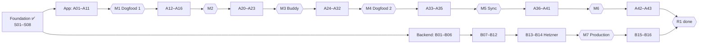

# 11 — Roadmap: Tracks, Milestones & Steps

_Two implementers build R1 in parallel on two tracks (TD-059, TD-063): the **app track** (Claude, `A01–A43`) and the **backend track** (Codex, `B01–B16`). Within a track the step number is the order; the only waits are the cross-track handoffs. Work is done in **steps** (`steps/`), each with a card. The **status board, milestones and handoffs live in `steps/README.md` §4–6**, the single place that tracks them._

## 1. Overview

- **Foundation (done):** S01 repo & CI, S02 contract pipeline, S03 backend host, S04 persistence, S06a/b app shell & Android builds, S08 domain primitives.
- **App track:** the manual tracker first (A01–A11 → **M1 Dogfood 1**, usable offline every day), then targets & weight (→ **M2**), Buddy core (→ **M3**, against the laptop server), Buddy breadth (→ **M4 Dogfood 2**), sign-in & sync (→ **M5**), workouts, insights, notifications & Ramadan (→ **M6**), then performance and the Play release.
- **Backend track:** the spikes and the laptop test server first (B01–B03), then identity, sync and deletion (B04–B06), the catalog and Buddy services (B07–B12), and **Hetzner last** (B13 staging, B14 production → **M7**), then the final eval and security review (B15, B16 → **R1**).

**Sizes:** S ≈ one session · M ≈ 1–2 sessions · L ≈ 2–3 sessions. If a low-level plan shows a step is bigger than L, split it (`A07a`, `A07b`) and update the board.

## 2. Milestones

The milestone table with exit criteria is in **`steps/README.md` §5**: M1 Dogfood 1 (offline tracker, A11) · M2 targets & weight (A16) · M3 Buddy on the laptop (A23 + B09's eval) · M4 Dogfood 2 (A31 + B09–B11) · M5 accounts & sync (A35) · M6 workouts, insights & Ramadan (A41) · M7 production (B14 + A43) · R1 done (A42, B15, B16, the deferred dish batches (TD-074), 2 weeks of exclusive use).

## 3. Servers until production (TD-064)

- **The phone is the source of truth** (TD-001), so everything except Buddy, online search, sign-in and sync works with no server at all. Dogfood 1 starts on the phone alone.
- **The laptop is the test server:** a separate stack (api + worker + Postgres, `main` images, not the dev stack) behind `tailscale serve`, reachable by the A55 over HTTPS from anywhere on the owner's tailnet, never from the internet (B03). Online features work whenever the laptop is on.
- **The owner's daily app is the prod flavor** (final app ID) pointing at the laptop, so its data never moves to another app (A11). When production exists, the laptop database moves into it and the build's URL switches (B14).
- **Hetzner comes last:** B13 starts when the app track reaches A38 (or earlier if the owner asks). The cost starts then.

## 4. Spec coverage

Every R1 requirement ID is assigned to at least one step card (see each card's **Spec** line). `tools/trace` (S01) checks that every R1 ID is covered by tests by the end (AT-001). Requirements implemented across several steps (e.g. AI-001 input bar: A08 layout, A22 behaviour) list each step.

## 5. R2 outline (friends)

Arabic UI + RTL + digit style (LC-003/004) · Arabic replies (AI-141), Arabic names on all foods and exercises (FD-005, WO-006), fuzzy Arabizi search (FD-024), AQ-11 parity gate with AR/Arabizi versions of every eval case (D-080) · **iOS enablement first** (D-081): iOS build pipeline (Codemagic/macOS runner), Apple Developer account, Sign in with Apple, TestFlight, iPhone pass of AT-004 · guided onboarding with age gate, health questions, demo card (UX-061, SF-001/002/013/040) · disordered-eating safeguards (SF-031/032) · recipe library + URL import (DY-050–052, AI-013) · progress photos, device-only (WB-050–052) · steps (HM-010) · widget + share sheet (UX-080/081) · hide workouts (WO-050) · "my version" of reference dishes (FD-053) · Navy body-fat estimate (WB-042) · fair-use limit (MN-020) · screen-reader labels (UX-072) · abuse protection (CAPTCHA/attestation) · Play closed testing + TestFlight · consent flows if telemetry is added (TQ-16) · decide N supported app versions (`04` §8).

## 6. R3 outline (public)

Paid tier + daily AI allowance + allowance UI (MN-001–007, AI-154) via store billing (StoreKit / Play Billing, possibly through RevenueCat) as a Billing module · shared user-added foods with verification (FD-072) · privacy policy EN/AR (AC-044) · zero data retention with the AI provider · licence review (OFF/ODbL) · device attestation on all API calls · infrastructure stage 2 (load balancer, replica, PgBouncer, `08` §3.2) · load tests of the API and sync · store listings and compliance · support tooling · SQLCipher decision.

## 7. What could change the order

- **B02 shows the AI is weaker than hoped on Arabic/Arabizi:** the Buddy steps grow (more prompt work, possibly a stronger model). The app's manual tracker (A01–A16) is unaffected, which is why it comes first.
- **B01 shows custom sync is risky:** switch to PowerSync (B05/A34 change shape, the rest doesn't).
- **A03 shows poor OFF coverage:** A28 makes the label-scan path the default flow.
- **The owner wants sync or production earlier:** A33–A35 can move before the Buddy steps, and B13/B14 can start any time (they only wait on the owner's choice, TD-064).
- **The laptop isn't practical as the server** (e.g. Buddy needed while it's off): bring B13/B14 forward.
