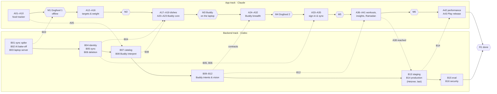

# Steps — How R1 Gets Built

R1 is built on **two tracks** that run in parallel (TD-059, TD-063):

- **App track `A01–A43`** (Claude): the Flutter app, the Dart packages and tools, the food data.
- **Backend track `B01–B16`** (Codex): the API, the Buddy server, infrastructure and deploys.

**Within a track the number is the order.** The only waits are the dependencies on the other track, shown in **bold** on the board (§4) and listed in §6. The finished foundation steps keep their old IDs (`S01`–`S04`, `S06a/b`, `S08`); old `Sxx` IDs are never reused, so a commit called `S04: …` is always the old plan and `A01: …` / `B01: …` the new one (§8).

**Servers:** until the end of R1 the owner's **laptop is the test server** for the phone (B03, over Tailscale). Hetzner staging and production come last (B13, B14), by the owner's choice (TD-064). The app is local-first, so the owner can use it daily long before that (milestone M1).

Each step is one focused session (or a few): **low-level plan → implementation → verification → outcome**, recorded in its **card** in this folder.

## 1. Session protocol

Every step session follows these phases. The owner can stop the session at the end of any phase.

> **Who does what:** each track has its own implementer (§4, TD-059/061). On the app track the main Claude session is the **orchestrator** and runs this protocol with the **`run-step`** skill. It delegates to specialist agents (`.claude/agents/`): `tech-researcher` and `step-planner` + `architect` in Phase B, the engineers per work package in Phase C, the reviewers and `verifier` in Phase D. Owner gates: **plan approval** (end of B) and **step acceptance** (end of E). Codex runs the same phases for the backend track from `AGENTS.md`. The full process (roles, decision rights, communication, quality gates) is in **`../13-delivery-process.md`**.

### Phase A: Orient (≈ 10 min)
1. Read this README's **status board** (§4) and pick the step per §7. Confirm its dependencies are ✅ (or, for "(contract)", that the contract commit is on `main`) and that `main` is green.
2. Read the step card, then the docs in its **Read first** list. Skim the **Outcome** sections of its dependencies, which may have changed assumptions.
3. If the card conflicts with reality (an earlier step deviated), note it and fix the card **before** planning.

### Phase B: Low-level plan (written into the card)
Fill the card's **Low-level plan** section:
- **Design:** types, interfaces, tables/migrations, endpoints (contract diff), screens, and how each "Decide in the low-level plan" item is resolved, with a one-line reason each. Number decisions `D1…` and review amendments `PA1…` (§8).
- **File list:** files to create or change.
- **Test list:** each test named with the spec ID it proves.
- **Task order:** a numbered checklist of small, committable tasks.
- **Risks / unknowns** and how the session will handle them.

**The owner reviews the plan** (approve, or comment and adjust) before implementation starts. For S-sized steps a quick skim is enough. Architecture-level choices become a TD entry in `12-decisions-and-questions.md`.

### Phase C: Implement
- Branch `step/<ID>-short-name` from `main` (e.g. `step/A01-local-data`).
- Work through the task list with small commits (Conventional Commits). Keep `make check test` green as you go.
- API changes: **contract first** → regenerate the client → implement the server → conformance green.
- Don't expand scope. Anything new goes into **Follow-ups** in the Outcome, or onto a later card.

### Phase D: Verify
- Tick every **Exit criteria** item, with evidence (test names, screenshots, a CI link, measured numbers).
- Run the full CI locally (`make check test`; `make eval` if AI-related).
- Demo to the owner when the card says so (e.g. on the A55).

### Phase E: Close
- Fill the card's **Outcome**: what was built, deviations from the plan (and why), follow-ups, new TDs, numbers measured.
- Update the **status board** (§4) and any planning doc the step changed (an outdated doc is a bug).
- Merge as one squash commit `<ID>: <step name>` through a CI-verified `merge/<ID>` branch (TD-036, TD-039, `../13-delivery-process.md` §3.E).

**If the step is bigger than planned:** split it at a natural seam (`A07a` done, `A07b` new card), close the finished part properly, and update the board.

**If the plan turns out to be wrong:** stop, write down why, propose the change (new TD or spec decision), and adjust later cards before continuing.

## 2. Card template

```markdown
# <ID> — <Title>

| Track | Depends on | Size | Owner | Status |
|---|---|---|---|---|
| App / Backend | A05, **B07** (contract) | S / M / L | Claude / Codex | ⬜ Not started |

**Goal.** One paragraph: what exists after this step that didn't before, and why it matters.

**Spec:** requirement IDs delivered (fully or partly) · **Decisions:** TD/D IDs that constrain this step

## Scope
- what's in

## Out of scope
- what's explicitly not in (and which step does it)

## Fixed by the plan
- design points already decided (don't re-litigate. If one seems wrong, raise it)

## Decide in the low-level plan
- open choices this session resolves

## Exit criteria
- [ ] verifiable checks

## Read first
- docs and sections

## Owner involvement
- what the owner provides or reviews

---

## Low-level plan
_Written in Phase B._

## Progress log
_One dated line per event, newest last (process §8a)._

## Outcome
_Written in Phase E: built · deviations · follow-ups · new TDs · measurements._
```

## 3. Owner prerequisites (accounts & inputs)

In the order they're needed:

| Needed by | What | Notes |
|---|---|---|
| **S01** ✅ | GitHub repository (public per TD-042), push via the laptop SSH key | Done 2026-10-12 |
| A02 | ~30 min to review the design gallery and mockups on the A55 (also covers S06b's deferred device check) | — |
| B02 | **OpenAI** project key only, GPT-6 Luna; a few small synthetic smoke prompts (TD-067) | Owner configured; no provider bake-off |
| B03 | A **Tailscale** account and the Tailscale app on the A55 (the phone reaches the laptop server through it) | Free |
| A03, dish batches | Skim each dish batch (≈ 15 min). Name family recipes to use (TQ-08) | — |
| A11 | A **Sentry** account (EU region) for crash reports | Free tier |
| B04 | A **Google Cloud** project with OAuth client IDs for Google sign-in (Android + web/server) | Free |
| B13 (near the end) | **Hetzner Cloud** account + API token. **A domain name** with DNS on **Cloudflare**. **Grafana Cloud** account | ≈ €10/mo staging + domain |
| B14 | A **second storage provider** for backup copies (e.g. Backblaze B2). An alert contact. An **email provider** account + DNS records (SPF/DKIM) for sign-in codes | Free tiers / a few € |
| A43 | **Google Play Console** ($25 once) | — |
| R2 (iOS, D-081) | Apple Developer Program ($99/yr), a Codemagic account | — |

## 4. Status board

**Owner** (TD-059, TD-061): **Codex** owns `backend/`, `infra/`, the server side of `contracts/`, the server CI jobs, deploys, `tools/buddy_eval` and the backend track. **Claude** owns `apps/mobile/`, `packages/`, the other Dart `tools/`, `data/`, the planning docs' structure and the app track.

**Depends on:** same-track IDs are plain, other-track IDs are **bold**. "**B09** (contract)" means the app step can start once B09's **contract handoff merge** is on `main` (`B09 (contract): …`: the contract, the regenerated client and `501` server stubs, TD-065), using the generated client + fakes; its end-to-end checks wait for the finished B step.

Legend: ⬜ not started · 🟦 planning · 🟨 in progress · ✅ done · ⏸ blocked

### 4.0 Foundation (done, old IDs)

| ID | Step | Owner | Status |
|---|---|---|---|
| [S01](S01-repo-tooling-ci.md) | Repo, tooling & CI foundation | Claude | ✅ |
| [S02](S02-api-contract-pipeline.md) | API contract pipeline | Claude | ✅ |
| [S03](S03-backend-host.md) | Backend host & HTTP conventions | Codex | ✅ |
| [S04](S04-backend-persistence.md) | Backend persistence, outbox & jobs | Codex | ✅ |
| [S06a](S06-app-shell.md) | App shell: skeleton | Claude | ✅ |
| [S06b](S06-app-shell.md) | App shell: Android builds & device | Claude | ✅ |
| [S08](S08-domain-primitives.md) | Domain primitives & text normalization | Claude | ✅ |

### 4.1 App track (Claude)

| ID | Step | Depends on | Size | Was | Milestone | Status |
|---|---|---|---|---|---|---|
| [A01](A01-local-data-foundation.md) | Local data foundation | S06 ✅, S08 ✅ | M | S09 |  | 🟦 wave 1 |
| [A02](A02-design-system.md) | Design system v0 & key screen mockups | S06 ✅ | L | S07 |  | 🟦 wave 1 |
| [A03](A03-spike-food-data.md) | Spike: food data | S08 ✅ | M | S11 |  | 🟦 wave 1 |
| [A04](dish-batches.md) | Dish batch 1: basics, breakfast & bread | A03 | S | D1 |  | 🟦 wave 1 |
| [A05](A05-catalog-pipeline.md) | Catalog pipeline & offline pack v1 | A01, A03, A04 | L | S13 |  | 🟦 wave 1 |
| [A05b](A05b-exercises-cities-data.md) | Exercises & cities data | A05 | S | S13 part |  | ⬜ |
| [A06](A06-diary-domain.md) | Diary domain & storage | A01 | M | S14 |  | 🟦 wave 1 |
| [A07](A07-food-search-add.md) | Food search & add flow | A02, A05, A06 | M | S15 |  | ⬜ |
| [A08](A08-today-diary-ui.md) | Today screen & diary UI | A07 | L | S16 |  | ⬜ |
| [A09](A09-personal-foods-quick-add.md) | Personal foods, saved meals & quick-add | A08 | M | S17 |  | ⬜ |
| [A10](A10-settings-slots.md) | Settings & meal slots | A08 | M | S18 |  | ⬜ |
| [A11](A11-dogfood-1-readiness.md) | Dogfood 1 readiness: export, crash reports, daily build | A09, A10 · soft: **B03** | M | S28 export part + new | **M1** | ⬜ |
| [A12](A12-targets-engine.md) | Targets engine | A06 | M | S19 |  | ⬜ |
| [A13](A13-targets-ui-onboarding.md) | Goals & targets UI, R1 onboarding | A10, A12 | M | S20 |  | ⬜ |
| [A14](A14-weigh-ins-trend.md) | Weigh-ins & trend | A08 | M | S21 |  | ⬜ |
| [A15](A15-weight-graph-measurements.md) | Weight graph & measurements | A12, A14 | L | S22 |  | ⬜ |
| [A16](A16-progress-tab.md) | Progress tab v1 | A13, A15 | M | S23 | **M2** | ⬜ |
| [A17](dish-batches.md) | Dish batch 2: main dishes A | A04 | S | D2 |  | ⬜ |
| [A18](dish-batches.md) | Dish batch 3: out & street food | A17 | S | D3 |  | ⬜ |
| [A19](dish-batches.md) | Dish batch 4: main dishes B, salads & sides | A18 | S | D4 |  | ⬜ |
| [A20](A20-api-session.md) | API session: anonymous identity & auth interceptor | **B04** (contract) | S | S25 part |  | ⬜ |
| [A21](A21-proposal-engine.md) | ProposalEngine | A07, A12, **B02** | L | S32 |  | ⬜ |
| [A22](A22-chat-proposal-card.md) | Chat sheet & proposal card | A08, A20, A21, **B08** | L | S33 |  | ⬜ |
| [A23](A23-message-lifecycle.md) | Message lifecycle, pending & failures | A22 | M | S34 | **M3** | ⬜ |
| [A24](A24-online-search-pack-updates.md) | Online search & pack updates (app) | A07, **B07** | M | S30 app part |  | ⬜ |
| [A25](A25-diary-edits-by-chat.md) | Diary edits by chat (app) | A23, **B09** (contract) | M | S35 app part |  | ⬜ |
| [A26](A26-memory-user-model.md) | Memory & user model (app) | A23, **B09** (contract) | M | S36 app part |  | ⬜ |
| [A27](A27-batches-chat-foods.md) | Batches, personal foods & saved meals by chat (app) | A09, A23, **B09** (contract) | L | S37 app part |  | ⬜ |
| [A28](A28-barcode-label-scan.md) | Barcode & label scan (app) | A23, **B10** (contract) | L | S38 app part |  | ⬜ |
| [A29](A29-photo-body-import.md) | Photo logging, body data by chat & paste import (app) | A15, A23, **B10** (contract) | M | S39 app part |  | ⬜ |
| [A30](dish-batches.md) | Dish batch 5: sweets, drinks & Ramadan staples | A19 | S | D5 |  | ⬜ |
| [A31](A31-qa-suggestions-halal.md) | Q&A, suggestions & halal (app) | A26, **B11** (contract) | M | S40 app part |  | ⬜ |
| [A32](dish-batches.md) | Dish batch 6: gap fill from dogfooding | A30 | S | D6 | **M4** | ⬜ |
| [A33](A33-sign-in-guest-app.md) | Sign-in & guest upgrade | A20, **B04** | M | S25 |  | ⬜ |
| [A34](A34-sync-engine-app.md) | Sync engine (app) | A33, **B05** | L | S27 |  | ⬜ |
| [A35](A35-account-deletion-app.md) | Account deletion (app) | A34, **B06** | S | S28 deletion part | **M5** | ⬜ |
| [A36](A36-workout-domain.md) | Workout domain, library & templates | A05b, A06, A12 | M | S41 |  | ⬜ |
| [A37](A37-workout-logging.md) | Workout logging, history & PRs (app) | A23, A36, **B12** (contract) | L | S42 app part |  | ⬜ |
| [A38](A38-adaptive-targets.md) | Adaptive targets & weekly check-in | A16, A23 | M | S43 |  | ⬜ |
| [A39](A39-weekly-review.md) | Weekly summary & Buddy review (app) | A37, A38, **B12** (contract) | M | S44 app part |  | ⬜ |
| [A40](A40-notifications.md) | Notifications | A27, A37, A39 | M | S45 |  | ⬜ |
| [A41](A41-ramadan.md) | Ramadan mode (app) | A05b, A15, A38, A40, **B12** (contract) | L | S46 app part | **M6** | ⬜ |
| [A42](A42-performance-a11y-offline.md) | Performance, accessibility & offline acceptance | A41 | M | S48 | **R1** | ⬜ |
| [A43](A43-play-internal-release.md) | Play internal testing release | A42, **B14** | S | S29 app part | **M7** | ⬜ |

### 4.2 Backend track (Codex)

| ID | Step | Depends on | Size | Was | Milestone | Status |
|---|---|---|---|---|---|---|
| [B01](B01-spike-sync.md) | Spike: sync | S04 ✅, S08 ✅ | M | S12 |  | ✅ |
| [B02](B02-spike-ai-bakeoff.md) | OpenAI interpretation spike & eval harness v0 | S03 ✅, S08 ✅ | L | S10 |  | ✅ |
| [B03](B03-laptop-test-server.md) | Laptop test server for the phone | S04 ✅ | S | new |  | ⬜ |
| [B04](B04-identity-backend.md) | Identity backend | S04 ✅ | L | S24 (real email sender → B14) |  | ⬜ |
| [B05](B05-sync-backend.md) | Sync backend | B01, B04 | M | S26 |  | ⬜ |
| [B06](B06-account-deletion-backend.md) | Account deletion (backend) | B04, B05 | M | S28 server part |  | ⬜ |
| [B07](B07-catalog-service.md) | Catalog service & online search | B04, **A05** | M | S30 server part |  | ⬜ |
| [B08](B08-buddy-interpret-service.md) | Buddy interpret service | B02, B07 | L | S31 |  | ⬜ |
| [B09](B09-buddy-intents-edits-memory-batches.md) | Buddy intents: edits, memory, batches & foods | B08, **A21** | M | S35–S37 server parts |  | ⬜ |
| [B10](B10-barcode-vision-import.md) | Barcode lookup, label & meal photos, paste import | B07, B08 | L | S38–S39 server parts |  | ⬜ |
| [B11](B11-buddy-qa-suggestions.md) | Buddy Q&A & suggestions | B08 | M | S40 server part |  | ⬜ |
| [B12](B12-buddy-workouts-review-ramadan.md) | Buddy workouts, weekly review & Ramadan | B08 | M | S42, S44, S46 server parts |  | ⬜ |
| [B13](B13-staging-infrastructure.md) | Staging on Hetzner & deploy pipeline | S04 ✅ · code any time; provisioning (cost) starts when the app track reaches **A38** (TD-064) | L | S05 |  | ⬜ |
| [B14](B14-production.md) | Production, backups & go-live | B13 | L | S29 server part | **M7** | ⬜ |
| [B15](B15-eval-expansion.md) | AI eval expansion & tuning | B09–B12, B14, **A41** | M | S47 | **R1** | ⬜ |
| [B16](B16-security-restore-drill.md) | Security review & restore drill | B14, **A42** | M | S49 | **R1** | ⬜ |



## 5. Milestones

| Milestone | Reached when | Exit (the milestone is reached when…) | Server |
|---|---|---|---|
| **M1 Dogfood 1: offline food tracker** | A11 | OF-01 food parts pass. A day of food can be logged by search and quick-add in airplane mode. The owner uses the prod build daily and can export | None needed (the laptop for `/v1/config` only) |
| **M2 Targets & weight** | A16 | Targets property tests pass. The owner's weight-note history is entered and charted | None |
| **M3 Buddy on the laptop** | A23 + B09's eval run | T01–T16, T19, T39–T41 meet the AQ thresholds (B09 runs the eval). p90 ≤ 5 s measured from the owner's location | Laptop (B03) |
| **M4 Dogfood 2: Buddy-first** | A31, A32 + B09–B11's eval runs | T17–T29, T33, T36–T38 pass. OF-02 passes. AT-003 green. The owner logs mostly through Buddy for a week | Laptop |
| **M5 Accounts & sync** | A35 (+ B05, B06) | OF-03 passes against the laptop server. Google sign-in, guest upgrade and account deletion work on the A55 | Laptop |
| **M6 Workouts, insights & Ramadan** | A41 (+ B12) | J9, J10, J11, T30–T35 pass. Every NT rule has a planner test | Laptop |
| **M7 Production** | B14 + A43 | The restore drill is done. AT-006 passes on production. The app installs from Play. The laptop's data has moved in | Hetzner (B13, B14) |
| **R1 done** | A42, A43 (M7), B15, B16 | AT-001 to AT-007 met. Every AQ threshold met on ≥ 150 cases. The owner uses it as the only tracker for 2 weeks. SC-1 checked at 4 weeks | Production |

**While the laptop is the server:** everything except Buddy, online search, sign-in and sync works with the laptop off (local-first). Online features work whenever the laptop runs the test-server stack + the Tailscale mapping (B03 runbook).

## 6. Cross-track handoffs

The only places one track waits for the other. The contract is the meeting point: a server step commits its contract change first, with a Progress-log line in its card, and the app builds against the generated client.

| From | To | What is handed over |
|---|---|---|
| **B03** laptop test server | A11 | The HTTPS URL the owner's daily build talks to |
| **A05** catalog pipeline | B07 | The catalog release format and server load files |
| **B02** AI bake-off | A21 | The interpretation schema the ProposalEngine consumes |
| **B04** identity (contract, then done) | A20, A33 | Anonymous tokens and refresh; sign-in and linking |
| **B08** Buddy interpret | A22 | The interpret endpoint, end to end |
| **A21** ProposalEngine | B09 | The `fb_domain` entry point the eval uses for full AQ metrics |
| **B07** catalog service | A24 | Online search and pack releases |
| **B09** intents (contract) | A25, A26, A27 | Edits, memory, batches, personal foods, saved meals |
| **B10** barcode & vision (contract) | A28, A29 | Barcode lookup, label extraction, photos, import |
| **B11** Q&A & suggestions (contract) | A31 | QueryPlans and suggestions |
| **B05** sync, **B06** deletion | A34, A35 | Push/pull/history; `DELETE /v1/me` |
| **B12** workouts, review, Ramadan (contract) | A37, A39, A41 | The last Buddy intents |
| App track reaches **A38** | B13 | The signal to provision Hetzner (TD-064); the code can be written earlier |
| **A41**, **A42** | B15, B16 | The finished app for the final eval and security review |
| **B14** production | A43 | The production URL and data for the Play release |

## 7. How to pick the next step

1. Take the **lowest-numbered step in your track** that isn't ✅.
2. If it waits on the other track or on an owner input (§3), tell the owner and take the next step in your track whose dependencies are met. Never start a step whose dependencies aren't met.
3. Steps marked 🟨 resume from their card's **Progress log**.

One folder, one implementer at a time (owner, 2026-10-16): both work in `~/work/fitness_buddy`. Before starting, check that the folder is clean (`git status`), commit and push your branch before handing over, and start your step branch from the latest `main`. Whoever merges second rebases on the new `main` first (`../13-delivery-process.md` §10).

## 8. Old → new IDs (TD-063)

The plan used one sequence `S01–S49` + dish batches `D1–D6` until 2026-10-16. The finished steps keep their IDs. Every other step got a track ID; old `Sxx` IDs are never reused. Finished cards and evidence files still mention old IDs in their history: read them through this table. New IDs: `A` = app, `B` = backend; the dish batches are ordinary app steps (no more `Dn`, which also clashed with spec decision IDs `D-0xx`).

**Look-alikes:** "the A55" is the owner's phone, never a step (the app track skips that number if it ever gets there). Inside a card, plan decisions are `D1…` and plan-review amendments `PA1…` (finished cards used `A1…`, e.g. `S06 A11` is S06's eleventh amendment, not step A11); cite them with their step from anywhere else (`A07 D3`).

| Old | New |
|---|---|
| S05 | B13 |
| S07 | A02 |
| S09 | A01 |
| S10 | B02 |
| S11 | A03 |
| S12 | B01 |
| S13 | A05 |
| S14 | A06 |
| S15 | A07 |
| S16 | A08 |
| S17 | A09 |
| S18 | A10 |
| S19 | A12 |
| S20 | A13 |
| S21 | A14 |
| S22 | A15 |
| S23 | A16 |
| S24 | B04 (real email sender → B14) |
| S25 | A33 (A20 = its anonymous-session part) |
| S26 | B05 |
| S27 | A34 |
| S28 | A35 (export → A11, server → B06) |
| S29 | B14 (Play release → A43) |
| S30 | B07 (app side → A24) |
| S31 | B08 |
| S32 | A21 |
| S33 | A22 |
| S34 | A23 |
| S35 | A25 (server → B09) |
| S36 | A26 (server → B09) |
| S37 | A27 (server → B09) |
| S38 | A28 (server → B10) |
| S39 | A29 (server → B10) |
| S40 | A31 (server → B11) |
| S41 | A36 |
| S42 | A37 (server → B12) |
| S43 | A38 |
| S44 | A39 (server → B12) |
| S45 | A40 |
| S46 | A41 (server → B12) |
| S47 | B15 |
| S48 | A42 |
| S49 | B16 |
| D1 (dish batch) | A04 |
| D2 (dish batch) | A17 |
| D3 (dish batch) | A18 |
| D4 (dish batch) | A19 |
| D5 (dish batch) | A30 |
| D6 (dish batch) | A32 |
